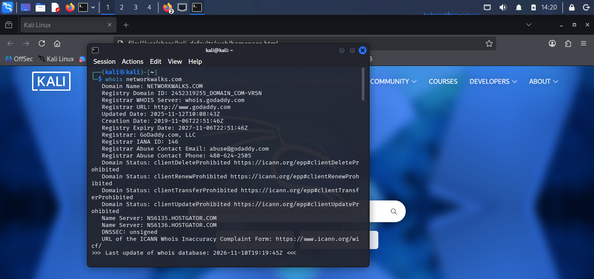
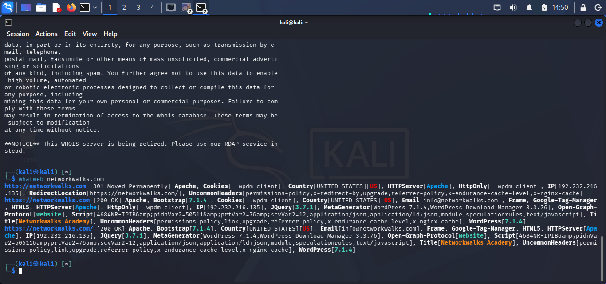
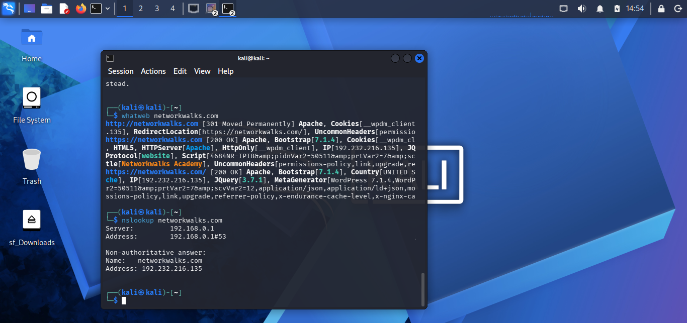
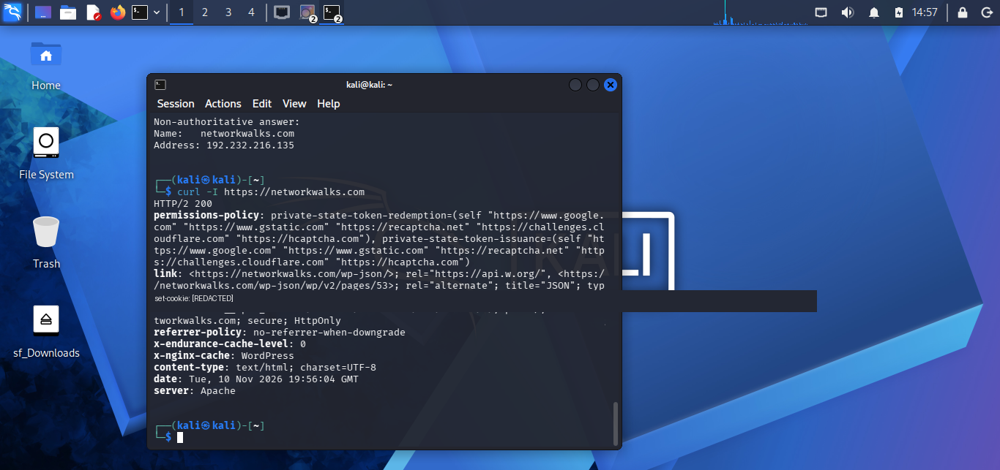
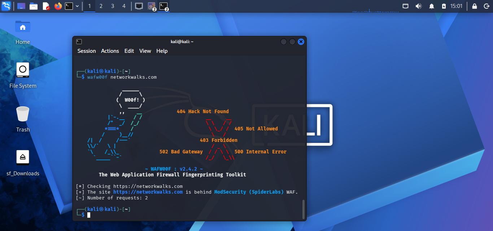
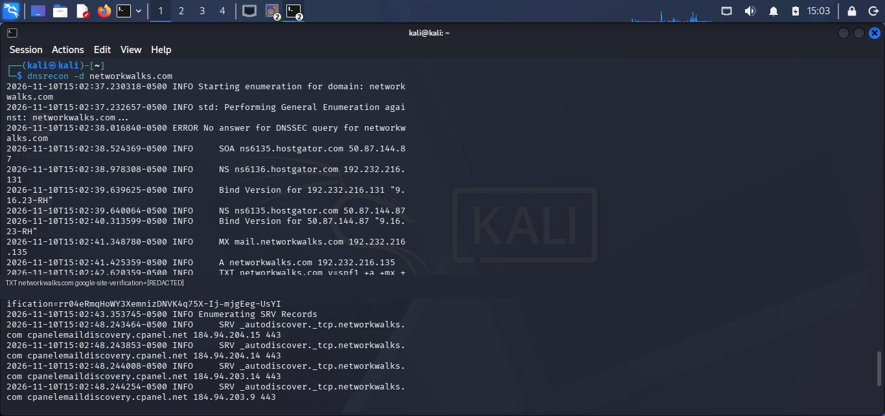
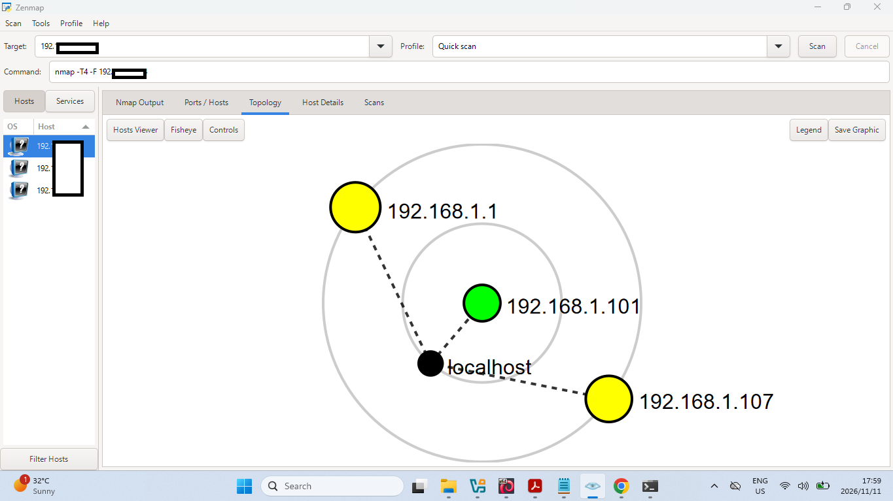

# Footprinting and Reconnaissance – Practical Report

**Student:** Lelo Mbhalati  
**Environment:** Kali Linux and Zenmap  
**Evidence:** Original practical screenshots supplied for this report.

> **Authorisation and scope:** Only assess systems and networks you own or have explicit permission to test. The screenshots document the activities shown; they do not establish permission to test the public domain `networkwalks.com`. Do not repeat active tests against it without the owner's authorisation.

## 1. Introduction
This practical exercise demonstrates introductory footprinting and reconnaissance: domain registration lookup, web technology fingerprinting, DNS queries and enumeration, HTTP response-header inspection, WAF fingerprinting, and local network scanning with topology visualisation. This report records only results visible in the supplied screenshots.

## 2. Tools Used
- Kali Linux
- Zenmap / Nmap
- WHOIS
- WhatWeb
- nslookup
- curl
- WAFW00F
- DNSRecon

## 3. Evidences Collected
The `Evidence/` folder contains seven original screenshots:
1. Zenmap network topology.
2. WHOIS domain registration lookup.
3. WhatWeb technology fingerprinting.
4. NSLookup DNS resolution.
5. Curl HTTP response headers (sensitive values redacted).
6. WAFW00F firewall detection.
7. DNSRecon DNS enumeration (sensitive values redacted).

## Activities Performed

### 4. Footprinting & Reconnaissance

### 4.1 WHOIS lookup
**Command:** `whois networkwalks.com`

The screenshot shows registration information including registrar, registration dates, nameservers and domain-status details. Personal/contact details are not reproduced here.

### 4.2  WhatWeb technology fingerprinting
**Command:** `whatweb networkwalks.com`

The visible output identifies technologies and characteristics including Apache, Bootstrap and WordPress. Fingerprinting reflects information observable at the time and does not, by itself, prove a vulnerability.

### 4.3  DNS lookup
**Command:** `nslookup networkwalks.com`

The screenshot shows a DNS query returning an IPv4 address through the configured resolver. DNS responses can change over time.

### 4.4 HTTP response-header inspection
**Command:** `curl -I https://networkwalks.com`

The screenshot shows an HTTP/2 200 response and returned headers. Cookie and potentially sensitive values are redacted in the supplied evidence.

### 4.5  WAF detection
**Command:** `wafw00f networkwalks.com`

The visible WAFW00F output reports ModSecurity (SpiderLabs). This is the tool's fingerprinting result, not a complete assessment of the site's security configuration.

 

### 4.6 DNS enumeration
**Command:** `dnsrecon -d networkwalks.com`

The visible output includes SOA, NS, MX, A, TXT and SRV record enumeration. The screenshot is partially truncated, so no unseen records or results are claimed.

### 5. Network Scanning with Zenmap
The Zenmap screenshot shows a Quick Scan using an Nmap command beginning `nmap -T4 -F` against a private local-network target. The topology view displays three discovered hosts and a localhost node. Some IP addresses are obscured, so they are not transcribed. The screenshot does not establish that any host was vulnerable or identify unshown operating systems or services.

## 6. Risk Analysis / Impact
These screenshots document information-gathering activities, not confirmed exploitation or compromise. General considerations:
- Public registration and DNS information can help an organisation understand its external information exposure.
- Technology fingerprinting can reveal platforms and server technologies that should be kept updated.
- HTTP headers may disclose configuration details; sensitive values should not be exposed.
- DNS and host discovery information can reveal infrastructure relationships.
- A WAF fingerprint indicates a reported protective technology, but does not prove that all application risks are mitigated.

No severity ratings or exploitable vulnerabilities are assigned because the screenshots do not establish them.

## 7. Recommendations
1. Obtain written authorisation and define scope before active scanning.
2. Keep servers, CMS platforms, plugins and frameworks patched.
3. Review HTTP security headers and secure cookie attributes.
4. Publish only necessary DNS records and review DNS configuration regularly.
5. Restrict administrative interfaces and services to trusted networks.
6. Monitor WAF alerts and maintain secure application configurations.
7. Store evidence securely and redact private IPs, tokens, cookies and personal details before public sharing.
8. Repeat assessments periodically within the approved scope and document verified findings separately.

## 8. Report
[PENETRATION TESTING REPORT.docx](https://github.com/user-attachments/files/34766670/PENETRATION.TESTING.REPORT.docx)

## 9. Conclusion
The exercise demonstrates introductory footprinting and reconnaissance using WHOIS, WhatWeb, nslookup, curl, WAFW00F and DNSRecon, together with local network scanning and topology visualisation using Zenmap/Nmap. The screenshots provide evidence of the commands and outputs visible during the exercise. The work highlights the value of reconnaissance and the importance of authorisation, careful interpretation and responsible handling of collected information.

## Repository contents
- `README.md` – overview and activity index.
- `Evidence/` – seven practical screenshots.
- `Reports/Practical-Report.md` – report following the lecture headings.
